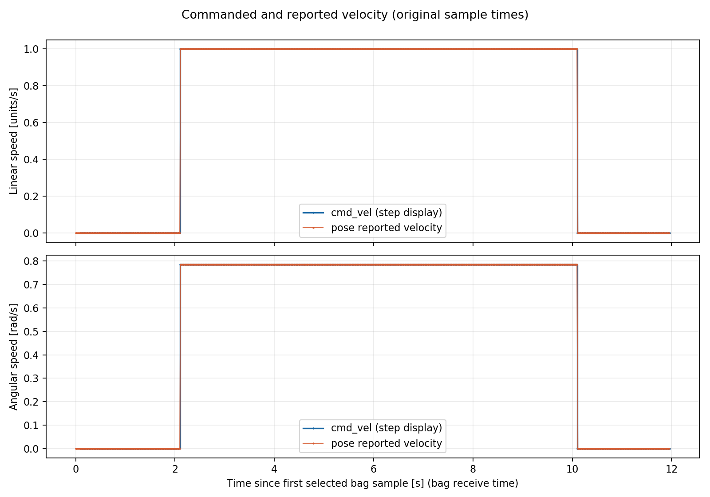
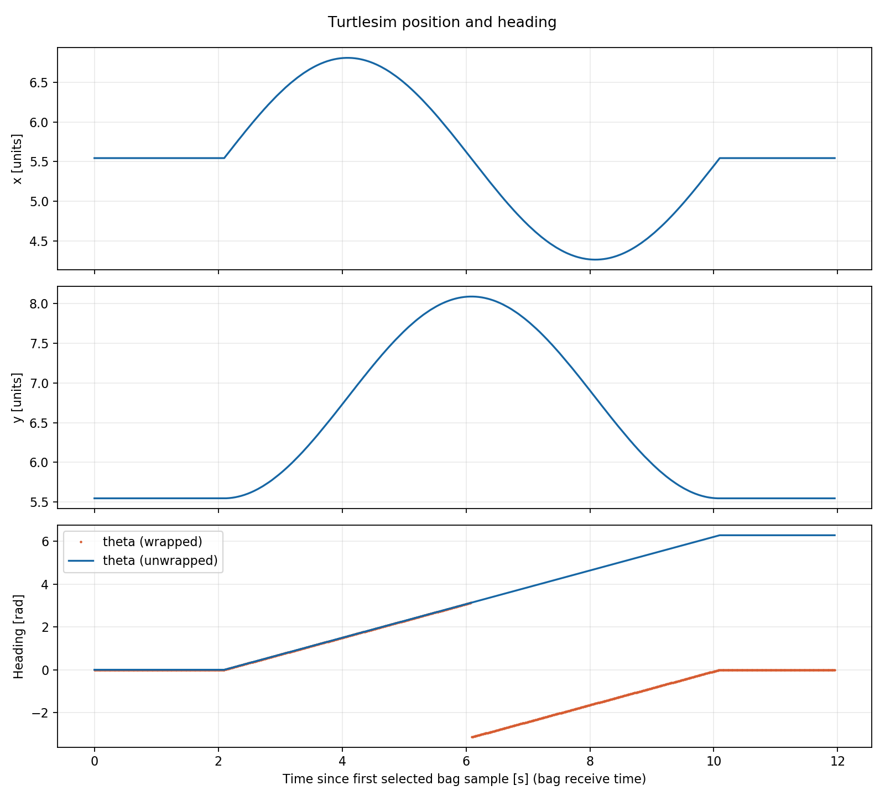
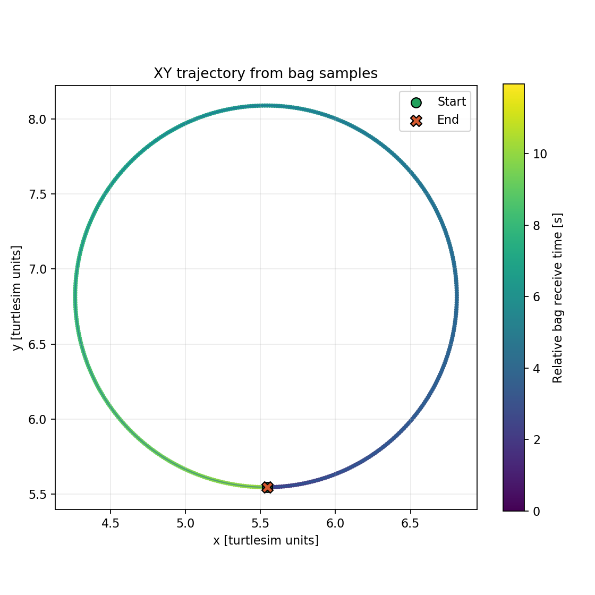
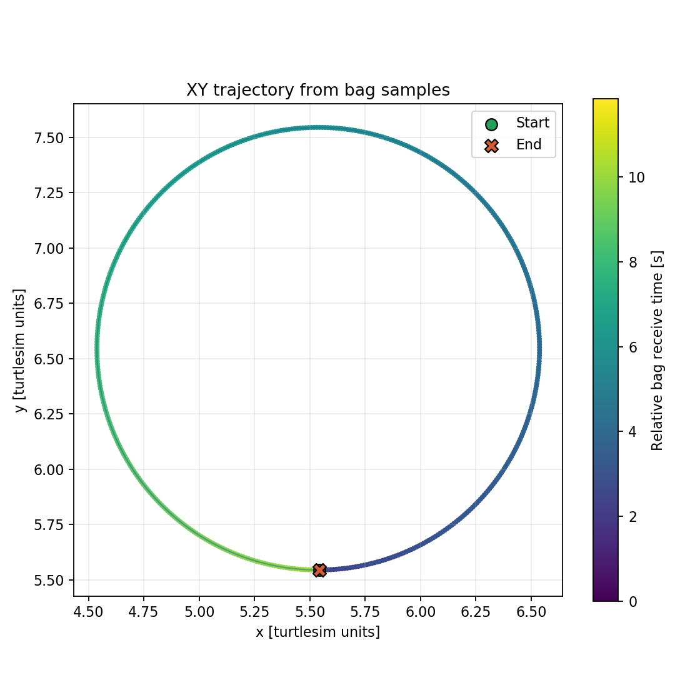
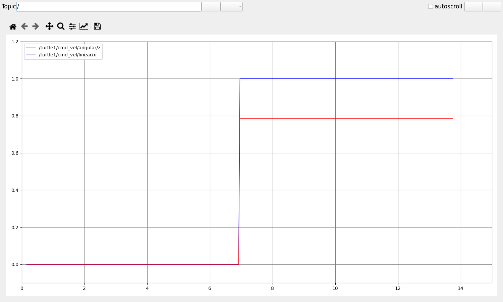
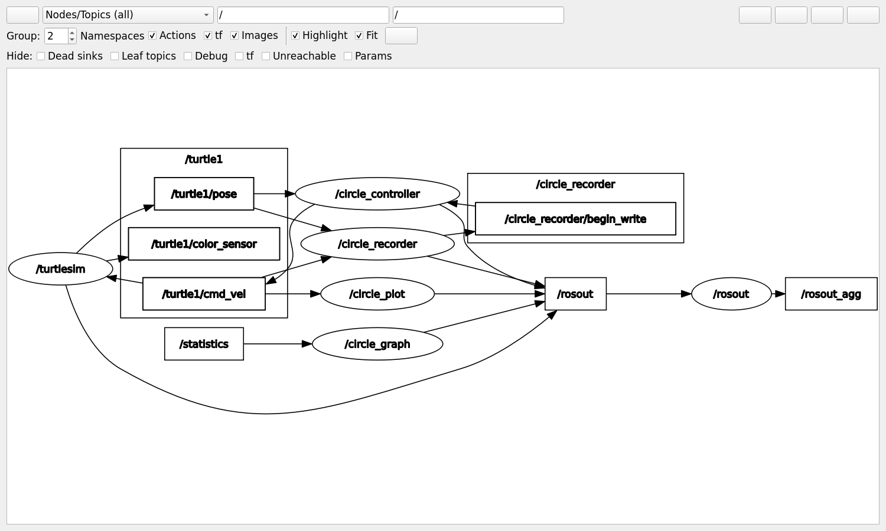
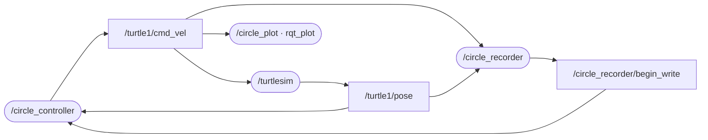

# turtlesim_circle

**可调周期与幅值的 ROS 1 小乌龟圆周运动实验。** 一条 launch 命令完成运动控制、速度/位置录包和 rqt 查看，再用 Python 输出时间曲线、轨迹与数据表。

目标环境：**Ubuntu 20.04 · ROS Noetic · Python 3 · catkin**。独立分析支持 **Python 3.10+**，无需安装 ROS。

[实验说明](docs/experiment.md) · [验证记录](docs/verification.md) · [常见问题](docs/troubleshooting.md) · [默认配置](config/circle.yaml)

- **两种幅值定义**：线速度大小 `speed`、圆半径 `radius`；周期均表示一圈所需时间。
- **ROS 参数在线调整**：周期、幅值、模式、方向；无效参数时输出零速度。
- **完整数据链**：`cmd_vel` 与 `pose` 同时录制，共用 bag 时间原点，保留独立采样点。
- **便于复现**：launch、中文实验步骤、离线测试和 ROS Noetic 集成工作流。

## 曲线预览

下图来自 **GitHub Actions 中实际运行的 ROS Noetic / turtlesim**，两种模式均使用 `T=8, A=1`、运动 8 秒。已通过构建、录包、分析和轨迹闭环检查：[成功运行记录](https://github.com/jjl5201314/turtlesim-circle-ros1/actions/runs/38447877114)。这些曲线由 Python 读取录制 bag 后生成；真实 rqt 插件界面见下文。

可直接下载仓库内的 [真实录包与分析结果](examples/ros1-recordings.zip)，来源、校验值与目录说明见 [examples/README.md](examples/README.md)。

| 速度随时间变化（speed） | 位置随时间变化（speed） |
| --- | --- |
|  |  |

| 线速度幅值模式：R ≈ 1.273 | 半径幅值模式：R = 1 |
| --- | --- |
|  |  |

### 实际 rqt 界面

下图为远端真实 ROS 运行中的 rqt 插件控件渲染（Qt offscreen），来源和复现方式见 [录包说明](examples/README.md)。rqt_plot 接收两条实时速度曲线；rqt_graph 展示全部节点/话题并保留日志连接。





## 快速开始

以下命令在**已安装 ROS Noetic** 的 Ubuntu 20.04 终端中执行。

项目仓库：[jjl5201314/turtlesim-circle-ros1](https://github.com/jjl5201314/turtlesim-circle-ros1)。这是私有仓库，仅允许有权限的 GitHub 账号访问。也可以把本地 `turtlesim_circle` 文件夹直接放入 `~/catkin_ws/src/`，跳过克隆步骤。

```bash
sudo apt update
sudo apt install ros-noetic-turtlesim ros-noetic-rosbag \
  ros-noetic-rqt-plot ros-noetic-rqt-graph \
  python3-numpy python3-matplotlib python3-nose

source /opt/ros/noetic/setup.bash
mkdir -p ~/catkin_ws/src
git clone https://github.com/jjl5201314/turtlesim-circle-ros1.git \
  ~/catkin_ws/src/turtlesim_circle
chmod +x ~/catkin_ws/src/turtlesim_circle/scripts/*.py

cd ~/catkin_ws
catkin_make
source devel/setup.bash
```

如果使用 ZIP，先解压，把 package 放入 `~/catkin_ws/src/turtlesim_circle/`，跳过 `git clone` 后执行其余构建步骤。确认 `package.xml` 直接位于该文件夹中，避免多嵌套一层目录。

每个新终端都需要 `source /opt/ros/noetic/setup.bash` 和 `source ~/catkin_ws/devel/setup.bash`。

### 启动、录制和分析

创建可写的录包目录，然后运行。`roslaunch` 会按需启动 ROS master。

```bash
mkdir -p ~/catkin_ws/bags
roslaunch turtlesim_circle circle.launch \
  amplitude_mode:=speed period:=8 amplitude:=1 direction:=1 \
  duration:=24 record:=true plot:=true graph:=true \
  bag_dir:="$HOME/catkin_ws/bags" bag_prefix:=circle_speed
```

控制器等待 turtlesim 和录包就绪后开始运动。`startup_delay` 默认 2 秒，便于记录静止阶段。这里设定 24 秒运动窗口，正常连续运行时约为 3 圈；到时持续发送零速度，launch 保持运行。**等待小乌龟停止后，再在 launch 终端按 Ctrl+C，使 rosbag 正常关闭文件。** `duration:=0` 表示持续运行到手动停止。

录制使用唯一文件名前缀并附加时间戳。正常结束 launch 后，查看完整文件名，把 `BAG` 的值改为本次文件路径：

```bash
ls -lh ~/catkin_ws/bags/*.bag
BAG="$HOME/catkin_ws/bags/实际文件名.bag"
rosbag info "$BAG"
```

确认 bag 中同时存在 `/turtle1/cmd_vel` 和 `/turtle1/pose`。录制期间的 `.bag.active` 还没有正常完成，应等待正常关闭后分析。

分析录制文件：

```bash
rosrun turtlesim_circle analyze_bag.py \
  --bag "$BAG" \
  --output-dir ~/catkin_ws/reports/circle_speed
```

输出文件：

| 文件 | 内容 |
| --- | --- |
| `velocity_vs_time.png` | 指令线速度、指令角速度，以及 pose 报告的线/角速度随时间变化 |
| `position_vs_time.png` | x、y、theta 随时间变化，包含展开后的连续角度 |
| `trajectory_xy.png` | 等比例 XY 轨迹 |
| `cmd_vel.csv` | 每条速度指令及 bag 时间 |
| `pose.csv` | 每条位姿、报告速度及 bag 时间 |
| `summary.json` | 来源、话题、样本数、时间范围、速度统计和路径长 |

分析默认保护已有结果；重复输出到同一目录时，请更换目录，或确认后加 `--overwrite`。

## 周期和幅值

记周期为 `T`，幅值为 `A`，旋转方向为 `d ∈ {−1, +1}`。角速度固定为 `ω = d·2π/T`。本文用 m 标注 turtlesim 的约定距离单位；它不代表真实机器人经过标定的物理尺度。

| `amplitude_mode` | 幅值含义 | 线速度 v | 圆半径 R |
| --- | --- | --- | --- |
| `speed`（默认） | 线速度大小 A，单位 m/s | `A` | `A·T/(2π)` |
| `radius` | 圆半径 A，单位 m | `2π·A/T` | `A` |

`period` 在两种模式下都表示“一圈所需时间”，不是速度指令的正弦振荡周期。匀速圆周运动需要恒定线速度和角速度，因此稳态的 `cmd_vel` 曲线是水平线。

例如 `T=8, A=1`：

- `speed`：`v=1 m/s`，`|ω|≈0.785398 rad/s`，`R≈1.273240 m`。
- `radius`：`v≈0.785398 m/s`，`|ω|≈0.785398 rad/s`，`R=1 m`。

改用半径模式：

```bash
roslaunch turtlesim_circle circle.launch \
  amplitude_mode:=radius period:=8 amplitude:=1 duration:=24 \
  record:=true plot:=true graph:=true \
  bag_dir:="$HOME/catkin_ws/bags" bag_prefix:=circle_radius
```

不要在同一个 ROS master 中同时启动两份该 launch；相同节点名会冲突。默认幅值适合从 turtlesim 初始位置运行。增大半径可能碰到窗口边界；此时位置被边界限制，实际轨迹不再是完整圆。

## ROS 参数

默认参数保存在 [`config/circle.yaml`](config/circle.yaml)。主要参数如下：

| 参数 | 默认值 | 含义 |
| --- | --- | --- |
| `period` | `8.0` | 一圈周期，秒，必须大于 0 |
| `amplitude` | `1.0` | 线速度幅值或半径，必须非负 |
| `amplitude_mode` | `speed` | `speed` 或 `radius` |
| `direction` | `1` | `1` 逆时针，`-1` 顺时针 |
| `rate` | `30.0` | 速度指令发布频率，范围 2～1000 Hz，仅启动时读取 |
| `duration` | `0.0` | 运动时间窗口，秒；0 表示持续运行 |
| `startup_delay` | `2.0` | 就绪后的启动延时，秒 |
| `pose_timeout` | `1.0` | 超过此秒数未收到有效 pose 时停车，必须大于 0 |

launch 先加载 YAML，只用明确传入的参数覆盖对应值，因此也可以直接修改配置文件，或传入 `config:=/path/to/circle.yaml`。`duration`、`startup_delay`、`pose_timeout` 与 `rate` 只在启动时读取。`record` 默认 true，`plot`、`graph` 默认 false；`bag_dir` 默认采用 `ROS_HOME`，未设置时为 `$HOME/.ros`；`bag_prefix` 默认 `circle`。自定义录包目录必须预先创建。

控制器在运行中持续检查有效位姿和连接。位姿超时、出现非有限数值或就绪条件丢失时发送零速度；条件恢复后，重新等待 `startup_delay` 再继续。`duration` 从首次运动开始按真实经过时间计时，暂停和恢复等待也计入，时间到后不再自动恢复运动。

运行中，在另一个已加载 ROS 环境的终端修改参数：

```bash
rosparam get /circle_controller
rosparam set /circle_controller/period 6.0
rosparam set /circle_controller/amplitude 0.8
rosparam set /circle_controller/amplitude_mode radius
rosparam set /circle_controller/direction -1
```

这些修改影响后续指令，不会重置小乌龟位置，也不会清除之前的轨迹。修改多个参数的过程中可能短暂经过中间组合；用于比较两次稳定实验时，建议分别启动并录制。周期为零、负幅值、非有限数或未知模式等无效配置会使控制器输出零速度并报告错误，避免继续使用错误参数。

## rqt_plot 与 rqt_graph

上面的 launch 已通过 `plot:=true graph:=true` 打开工具。也可以先用 `plot:=false graph:=false` 启动，再在**两个独立终端**分别执行：

```bash
rosrun rqt_plot rqt_plot \
  /turtle1/cmd_vel/linear/x /turtle1/cmd_vel/angular/z
```

```bash
rosrun rqt_graph rqt_graph
```

在 rqt_plot 中确认有两条曲线：`linear/x` 单位 m/s，`angular/z` 单位 rad/s。它们量纲不同，比较数值时注意单位；启动和停止阶段应有零值，稳态分别为 v 和 ω。

在 rqt_graph 中选择 **Nodes/Topics (all)**，取消隐藏调试节点、叶子话题等过滤项，点击刷新。保持录包器和 rqt_plot 运行，才能看到它们的连接。`rqt_graph` 是观察 ROS 图的工具，不一定会通过用户数据话题形成一条连接；`/rosout`、颜色话题、工具自身节点等也可能出现在完整图里。

核心数据流的**预期示意**如下，实际节点/话题清单以现场 rqt_graph 为准：



可用 `rosnode list`、`rostopic list`、`rostopic info /turtle1/cmd_vel` 和 `rostopic info /turtle1/pose` 对照检查。

## 不依赖 ROS 的离线分析

默认 `--backend auto` 优先尝试当前环境可用的 ROS 1 `rosbag`；也支持不依赖 ROS 安装的 `rosbags` 后端。下面的 Python 命令均在项目根目录（`requirements-analysis.txt` 所在目录）执行：

```bash
python -m pip install -r requirements-analysis.txt
python scripts/analyze_bag.py --bag "/path/to/circle.bag" \
  --output-dir "/path/to/report" --backend rosbags
```

ROS Noetic 原生 Python 3.8 环境建议使用系统的 `rosbag`、NumPy、Matplotlib；上述独立分析依赖针对 Python 3.10+，不必和 ROS 运行环境相同。

若话题被重映射，使用 `--cmd-topic /your/cmd_vel --pose-topic /your/pose`。输入必须包含这两类消息；缺少话题、类型不匹配、空数据或损坏文件应先处理后再分析。

`Twist` 和 `turtlesim/Pose` 不含消息头时间戳，脚本使用 **bag 记录时间**。两组数据共享同一个零点，不会各自从零开始，也不会强制插值为同一采样频率。记录和传输造成的少量相对延迟是正常现象。theta 原始值在 ±π 附近跳变，展开角度用于观察连续转圈；这不表示发生突然倒转。角度展开要求相邻采样之间的实际转角小于 π；旋转过快或采样严重缺失时，不能据此可靠恢复圈数。

## 生成示例与运行测试

没有 ROS 时，可在独立 Python 3.10+ 环境中验证分析流程：

```bash
python -m pip install -r requirements-analysis.txt
python scripts/generate_demo_bag.py --output demo/synthetic_speed.bag \
  --amplitude-mode speed --period 8 --amplitude 1
python scripts/analyze_bag.py --bag demo/synthetic_speed.bag \
  --output-dir demo/synthetic_speed_report --backend rosbags
```

将模式改为 `radius`、输出文件名改为 `synthetic_radius.bag`，即可生成第二种模式的示例。默认包含 2 秒静止、3 圈运动、1 秒静止。生成器拒绝覆盖既有示例，将来源声明写入 bag 的 `/turtlesim_circle/synthetic_provenance` 话题，并生成同名 `.provenance.json` 说明文件。因此单独复制 bag 后，分析器仍能识别合成来源，给图标注 **SYNTHETIC DEMO - no live ROS run**；建议同时保留说明文件以便阅读。

`summary.json` 保存 bag 的 SHA-256 和来源信息，带有校验值的来源文件必须与 bag 匹配。没有来源声明只表示来源未经分析器验证，不能据此认定为真实 ROS 录制。

离线测试命令：

```bash
python -m pip install -r requirements-analysis.txt pytest
python -m pytest -q tests
```

仓库还配置了 GitHub Actions：Python 测试，以及 ROS Noetic 容器中构建、运行两种模式、录包和分析的集成检查。运行状态以 [Actions 页面](https://github.com/jjl5201314/turtlesim-circle-ros1/actions) 为准；集成检查还保存真实 rqt 插件界面图及完整 ROS 图；用户电脑上的桌面显示效果需在目标环境确认。具体已核实的验证结果见 [验证记录](docs/verification.md)。

在 ROS 工作空间中也可以运行运动模型与控制器单元测试：

```bash
cd ~/catkin_ws
catkin_make run_tests_turtlesim_circle
catkin_test_results
```

## 项目结构

```text
turtlesim_circle/
├── config/circle.yaml          # 默认 ROS 参数
├── launch/circle.launch        # 仿真、控制与录包
├── launch/visualize.launch     # rqt 工具
├── scripts/circle_controller.py
├── scripts/analyze_bag.py
├── scripts/generate_demo_bag.py
├── src/turtlesim_circle/motion.py
├── tests/                      # 参数、控制器和分析测试
├── docs/                       # 实验、验证记录与预览图
├── examples/                   # 真实录包、曲线与 rqt 界面归档
└── .github/workflows/          # Python / ROS Noetic 检查
```

## 参考资料

- [ROS turtlesim：Noetic 源码](https://github.com/ros/ros_tutorials/tree/noetic-devel/turtlesim)
- [ROS rosbag：Noetic 源码](https://github.com/ros/ros_comm/tree/noetic-devel/tools/rosbag)
- [rqt_plot 官方仓库](https://github.com/ros-visualization/rqt_plot)
- [rqt_graph 官方仓库](https://github.com/ros-visualization/rqt_graph)
- [Rosbags 官方文档](https://ternaris.gitlab.io/rosbags/)

本项目的运行命令针对 Noetic；参考仓库的默认分支可能属于其他 ROS 发行版。
